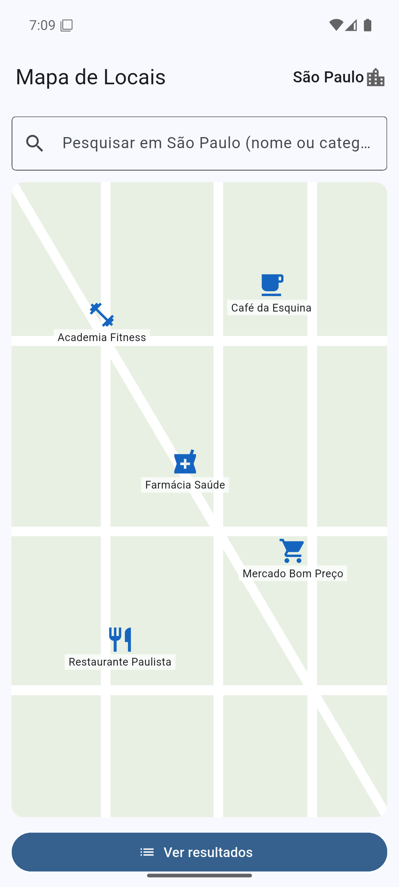
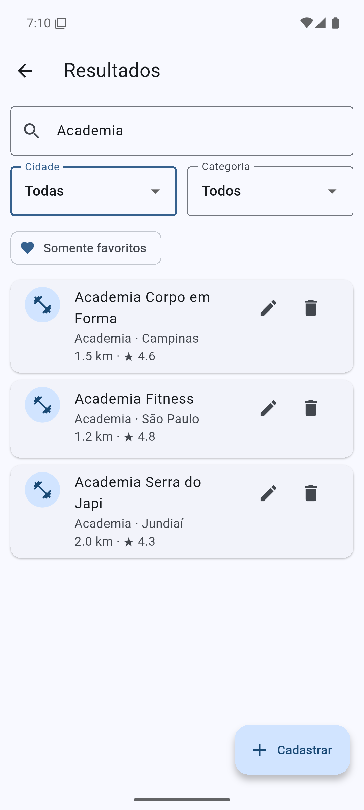
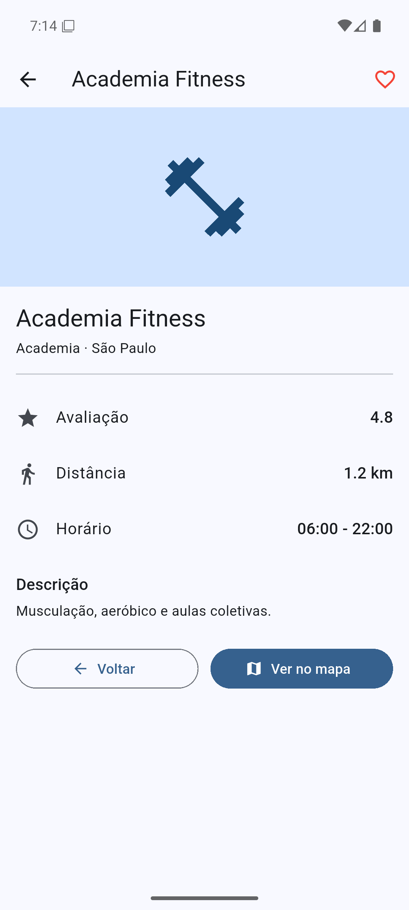

# Mapa de Locais — Flutter + Firebase Cloud Firestore

Aplicação mobile de localização de estabelecimentos: mapa, pesquisa, resultados e detalhes, com os dados armazenados no Cloud Firestore.

## 1. Problemática

Uma empresa precisa de um aplicativo para os usuários localizarem serviços e estabelecimentos em diferentes cidades. O usuário escolhe a cidade, pesquisa o que procura, filtra os resultados, abre os detalhes de um estabelecimento e marca locais como favoritos. Além disso, é preciso cadastrar novos locais e alterar ou excluir os existentes, sem dados fixos no código.

## 2. Objetivo

Desenvolver em Flutter uma aplicação de três telas (Mapa, Resultados e Detalhes) que lê e grava os locais na coleção `locais` do Cloud Firestore, com CRUD completo, pesquisa, filtros e favoritos.

## 3. Requisitos funcionais

| Código | Requisito | Como foi atendido |
|---|---|---|
| RF01 | Selecionar cidade | Seletor na barra superior do mapa: São Paulo, Campinas e Jundiaí. |
| RF02 | Pesquisar | Campo de pesquisa por nome ou categoria no mapa e nos resultados. |
| RF03 | Consultar Firestore | `LocalService.listarLocais()` usa `snapshots()` da coleção `locais`. |
| RF04 | Filtrar | Filtros de cidade, categoria e "Somente favoritos" na tela de resultados. |
| RF05 | Cadastrar local | Botão "Cadastrar" abre um Bottom Sheet e chama `locais.add()`. |
| RF06 | Editar local | Ícone de lápis abre o mesmo formulário preenchido e chama `doc(id).update()`. |
| RF07 | Excluir local | Ícone de lixeira pede confirmação e chama `doc(id).delete()`. |
| RF08 | Detalhes | Tela de detalhes com todas as informações do local. |
| RF09 | Favoritar | Coração na tela de detalhes altera o campo `favorito` no Firestore. |
| RF10 | Navegação | Mapa → Resultados → Detalhes, com "Voltar" e "Ver no mapa". |

## 4. Requisitos não funcionais

- Desenvolvido em Flutter/Dart, com o banco Cloud Firestore.
- Configurado com FlutterFire CLI (`lib/firebase_options.dart`).
- Funciona em Android (testado no emulador) e também na Web (Chrome).
- Código organizado em pastas: `models`, `services`, `screens`, `widgets` e `dialogs`.
- A exclusão sempre pede confirmação.
- Toda operação no banco mostra uma mensagem (SnackBar) de sucesso ou de erro.
- O formulário valida os campos: nome e horário obrigatórios, avaliação entre 0 e 5, distância numérica.

## 5. Tecnologias utilizadas

| Tecnologia | Uso |
|---|---|
| Flutter / Dart | Interface e lógica da aplicação |
| Firebase | Backend da aplicação |
| Cloud Firestore | Banco de dados NoSQL (coleção `locais`) |
| FlutterFire CLI | Configuração do Firebase no Flutter |
| Firebase CLI | Criação do projeto, do banco e publicação das regras |
| Pacotes | `firebase_core`, `cloud_firestore` |

## 6. Arquitetura do projeto

```
lib/
├── main.dart                  # Inicializa o Firebase e abre a MapaScreen
├── firebase_options.dart      # Gerado pelo FlutterFire (não editar)
├── models/
│   ├── local.dart             # Model Local (fromMap/toMap), cidades, categorias e filtrarLocais()
│   └── avaliacao.dart         # Model Avaliacao e média das notas
├── services/
│   ├── local_service.dart     # Único ponto de acesso ao Firestore (CRUD, favoritos, avaliações)
│   └── auth_service.dart      # Lista de administradores e mensagens de erro do login
├── screens/
│   ├── login_screen.dart      # Entrar / criar conta
│   ├── mapa_screen.dart       # Tela 1: cidade, pesquisa, mapa real com marcadores
│   ├── resultados_screen.dart # Tela 2: lista, pesquisa, filtros e CRUD
│   └── detalhes_screen.dart   # Tela 3: detalhes, favorito, voltar e ver no mapa
├── widgets/
│   ├── local_card.dart        # Item da lista de resultados
│   └── local_form.dart        # Formulário de cadastro/edição (Bottom Sheet)
└── dialogs/
    └── confirm_delete.dart    # Confirmação de exclusão
test/widget_test.dart          # Testes de unidade (filtros e Model)
firestore.rules                # Regras de segurança do Firestore
tool/                          # Scripts de configuração (Firebase, Android) e dados iniciais
```

As telas não falam diretamente com o banco: elas chamam o `LocalService`, que converte os documentos em objetos `Local`. As listas usam `StreamBuilder` com `snapshots()`, por isso qualquer cadastro, edição, exclusão ou favorito aparece na hora, sem recarregar a tela. A pesquisa e os filtros são aplicados em memória pela função `filtrarLocais()`, como sugere o tutorial.

O mapa da tela principal é uma representação ilustrativa (ruas desenhadas e marcadores por categoria), como permite o enunciado. O mapa real é o desafio extra Nível 2.

## 7. Modelo da coleção `locais`

| Campo | Tipo | Exemplo |
|---|---|---|
| nome | String | "Academia Fitness" |
| categoria | String | "Academia" (Academia, Restaurante, Farmácia, Mercado, Café) |
| cidade | String | "São Paulo" (São Paulo, Campinas, Jundiaí) |
| avaliacao | Number | 4.8 |
| distancia | Number | 1.2 (km) |
| horario | String | "06:00 - 22:00" |
| descricao | String | "Musculação, aeróbico e aulas coletivas." |
| favorito | Boolean | false |

O ID do documento é gerado automaticamente pelo Firestore e guardado no campo `id` do Model, para que edição, exclusão e favorito saibam qual documento alterar. O banco tem 15 locais iniciais, 5 por cidade (arquivo `tool/seed_locais.json`).

## 8. Operações CRUD

| Operação | Método no Firestore | Onde | Objetivo |
|---|---|---|---|
| Create | `locais.add(local.toMap())` | Botão "Cadastrar" (Resultados) | Cadastrar local |
| Read | `locais.orderBy('nome').snapshots()` | Mapa e Resultados | Listar locais em tempo real |
| Update | `locais.doc(id).update(...)` | Lápis (Resultados) e coração (Detalhes) | Editar local ou favorito |
| Delete | `locais.doc(id).delete()` | Lixeira (Resultados), após confirmação | Excluir local |

Todas as chamadas ficam dentro de `try/catch`. Em caso de sucesso aparece uma mensagem como "Local cadastrado.", e em caso de erro uma mensagem vermelha com o motivo.

## 9. Regras de segurança

O arquivo `firestore.rules` fecha todo o banco, exceto as coleções abaixo:

| Caminho | Leitura | Gravação |
|---|---|---|
| `locais/{id}` | Qualquer usuário logado | Só administradores. O documento precisa ter os campos do modelo, com os tipos corretos, nome entre 1 e 100 caracteres, avaliação entre 0 e 5 e distância maior ou igual a 0. |
| `locais/{id}/avaliacoes/{uid}` | Qualquer usuário logado | Só o próprio usuário (o documento tem o `uid` dele), com nota inteira de 1 a 5 e comentário de até 500 caracteres |
| `usuarios/{uid}` | Só o dono | Só o dono, e apenas o campo `favoritos` |

Sem login, qualquer leitura ou gravação é recusada pelo servidor com erro 403. Isso foi conferido chamando a API REST do Firestore sem autenticação.

## 10. Desafios extras

| Nível | Desafio | Situação |
|---|---|---|
| 1 | Imagens no Firebase Storage | **Não feito.** Desde 2024 o Firebase exige o plano pago (Blaze) para criar o bucket do Storage em projetos novos. |
| 2 | Mapa real | **Feito.** O mapa usa OpenStreetMap pelo pacote `flutter_map`, sem chave de API. Cada local tem `latitude` e `longitude`, o mapa centraliza na cidade escolhida e "Ver no mapa" centraliza e destaca o local em vermelho. |
| 3 | Autenticação | **Feito.** Login e cadastro por e-mail e senha (Firebase Authentication). Os administradores (lista `emailsAdmin` em `auth_service.dart` e função `admin()` nas regras) cadastram, editam e excluem locais. Usuários comuns só consultam, favoritam e avaliam, e os botões de edição nem aparecem para eles. |
| 4 | Consultas no Firestore | **Feito.** Os filtros de cidade e categoria viram `where()` com `orderBy('nome')` no próprio Firestore, usando os índices compostos de `firestore.indexes.json`. A busca por texto continua em memória, porque o Firestore não tem busca por trecho de texto. |
| 5 | Favoritos por usuário | **Feito.** Cada usuário tem o documento `usuarios/{uid}` com a lista `favoritos`, alterada com `arrayUnion`/`arrayRemove`. O campo `favorito` do local continua no modelo da atividade, mas o app usa a lista do usuário. |
| 6 | Avaliações | **Feito.** Na tela de detalhes, cada usuário dá de 1 a 5 estrelas e um comentário. A tela mostra a média e a lista de avaliações. |

Com o login, o app passou a ter uma tela de entrada antes das três telas principais.

## 11. Testes

Testes de unidade automatizados (`flutter test`): pesquisa sem diferenciar maiúsculas, filtro por cidade e categoria, filtro pelos favoritos do usuário, conversão `fromMap`/`toMap` (inclusive a posição padrão no centro da cidade) e média das avaliações. Resultado: **5 de 5 passaram**. O `flutter analyze` não encontrou problemas.

Testes obrigatórios da atividade, executados em 28/10/2026 no emulador Android (Pixel 7, Android 16 / API 36), na versão anterior aos desafios extras (sem login e com o mapa ilustrativo). As evidências estão em `docs/prints/testes/`.

| ID | Teste | Procedimento | Resultado | Evidência |
|---|---|---|---|---|
| T01 | Conexão | Abrir o aplicativo e verificar se os dados do Firestore aparecem. | **Passou**: os 5 locais de São Paulo aparecem como marcadores no mapa. | [T01](docs/prints/testes/T01.png) |
| T02 | Pesquisa | Pesquisar por 'Academia'. | **Passou**: com cidade "Todas", aparecem as 3 academias. | [T02](docs/prints/testes/T02.png) |
| T03 | Cidade | Selecionar Campinas. | **Passou**: o mapa passa a mostrar os 5 locais de Campinas. | [T03](docs/prints/testes/T03.png) |
| T04 | Filtro | Selecionar uma categoria. | **Passou**: a categoria "Farmácia" mostra só as 3 farmácias. | [T04](docs/prints/testes/T04.png) |
| T05 | Create | Cadastrar um novo local e verificar no Firestore. | **Passou**: "Academia Nova Era" cadastrada, mensagem "Local cadastrado." e documento confirmado no Firestore (16 documentos). | [T05](docs/prints/testes/T05.png) |
| T06 | Read | Fechar/reabrir a tela e verificar o registro. | **Passou**: depois de voltar ao mapa e reabrir os resultados, o local continua na lista. | [T06](docs/prints/testes/T06.png) |
| T07 | Update | Editar nome ou horário e confirmar a alteração. | **Passou**: horário alterado de 07:00 - 21:00 para 08:00 - 20:00, com mensagem "Local atualizado.". | [T07](docs/prints/testes/T07.png), [detalhes](docs/prints/testes/T07b.png) |
| T08 | Delete | Excluir um local e confirmar que desapareceu. | **Passou**: o app pede confirmação, mostra "Local excluído." e o documento sai do Firestore (15 documentos). | [confirmação](docs/prints/testes/T08a.png), [T08](docs/prints/testes/T08.png) |
| T09 | Favorito | Marcar e desmarcar um local. | **Passou**: o coração alterna, com as mensagens "Adicionado aos favoritos." e "Removido dos favoritos.". | [marcar](docs/prints/testes/T09a.png), [desmarcar](docs/prints/testes/T09b.png) |
| T10 | Navegação | Abrir resultados e detalhes e retornar. | **Passou**: Mapa → Resultados → Detalhes → "Ver no mapa" volta ao mapa com o marcador destacado em vermelho. | [T10](docs/prints/testes/T10.png) |
| T11 | Erro | Simular ausência de dados/erro e verificar mensagem. | **Passou**: uma pesquisa sem resultado mostra "Nenhum local encontrado.". Falhas de banco aparecem em SnackBar vermelho, e falhas de leitura em "Erro ao carregar os locais.". | [T11](docs/prints/testes/T11.png) |

## 12. Capturas de tela

| Mapa principal | Resultados | Detalhes |
|---|---|---|
|  |  |  |

Print do Firestore com os documentos cadastrados: `docs/prints/firestore.png`, tirado do [console do Firebase](https://console.firebase.google.com/project/mapa-locais-4741/firestore).

## 13. Como executar

```bash
flutter pub get
flutter run
```

Para recriar o ambiente do zero: `tool/setup_firebase.ps1` (projeto Firebase, Firestore, FlutterFire, regras e dados iniciais) e `tool/setup_android.ps1` (SDK e emulador Android).

## 14. Conclusão

O desenvolvimento seguiu as etapas do tutorial: primeiro a conexão Flutter + Firebase, depois a leitura dos dados, o CRUD e, por fim, detalhes, favoritos, filtros e o acabamento visual. Separar o acesso ao banco em um serviço (`LocalService`) e os dados em um Model (`Local`) deixou as telas simples e facilitou os testes. Como o Firestore entrega as mudanças em tempo real por `snapshots()`, a interface fica sempre sincronizada com o banco. Os principais pontos de melhoria são o login com regras por usuário, o mapa real e as consultas feitas direto no Firestore com `where()` e `orderBy()`.
